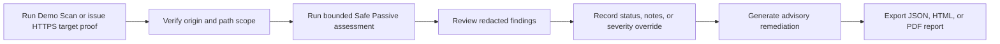

# Arzens Sentinel

> **A portfolio-ready, AI-assisted vulnerability scanner and remediation workspace for authorized web-security assessments.**

Arzens Sentinel turns the internship proposal into a polished end-to-end security-operations product: an authenticated dashboard, bounded safe-passive scanner, explainable finding model, review workflow, structured remediation guidance, professional reports, shared-core CLI, and local-only OWASP ZAP adapter boundary.

## Why this implementation is stronger than the original proposal

The proposal’s Python/Streamlit/ZAP direction was valuable as a starting point, but a single-process Python UI tightly couples interface and scanner responsibilities. This implementation uses a typed React + TypeScript application with a separate scanner-core so the dashboard, server procedures, CLI, scoring, reports, and future ZAP adapter share one predictable security model.

| Proposal goal | Production-minded implementation |
|---|---|
| Automated web/API crawler | Bounded same-origin HTTP(S) scanner with strict URL/DNS/redirect SSRF checks and page/response/time limits. |
| Risk scoring | Stable rule IDs with transparent impact/exploitability factors and preserved original severity. |
| LLM remediation | Server-side strict-schema guidance, evidence grounding, advisory labels, deterministic fallback, and no automatic patch application. |
| PDF reporting | Redacted JSON, print-ready HTML, and server-generated PDF artifacts stored outside the database. |
| OWASP ZAP | Local-only alert-normalization boundary with fixture tests and lab documentation. |

## Core workflow



## Feature highlights

The dashboard provides overview metrics, assessment history, a safe scan-creation flow, detailed findings review, severity filters, endpoint coverage, activity trail, report controls, methodology, and responsive accessible states. The Demo Scan is fixture-backed and does **not** target an external system.

The scanner defaults to **Safe Passive**. Live targets require an HTTPS `/.well-known/` proof file, a verified origin and path scope, policy snapshot, expiry, revocation path, and audit trail before an assessment begins. The transport validates protocols, blocks private/loopback/link-local/reserved/metadata and mixed-DNS targets, pins the validated DNS answer at connection time, re-validates redirects, bounds crawling and wall-clock duration, observes only in-scope links, and redacts sensitive-looking evidence before database, report, or AI use.

## Local quick start

```bash
pnpm install
pnpm check
pnpm test
pnpm dev
```

The managed web project supplies authentication, database credentials, and secure object storage. For the reviewer path, sign in and click **Run Demo Scan**. For authorized live testing, use **New assessment** to issue and verify a proof file before starting the bounded hosted scan.

## CLI

The CLI uses the same scanner-core and report renderer as the web application.

```bash
# Zero-network fixture demonstration
pnpm cli -- --demo --format json --output ./reports

# Authorized target only; non-zero exit code if high+ findings occur
pnpm cli -- --target https://app.example.com --authorized --format pdf --max-pages 4 --timeout-ms 8000 --fail-on high
```

| Option | Purpose |
|---|---|
| `--demo` | Uses a controlled fixture only; no third-party network target. |
| `--target <url>` | Runs the bounded Safe Passive scanner against an authorized HTTP(S) target. |
| `--format json|html|pdf` | Chooses the report artifact type. |
| `--output <directory>` | Writes the local report directory. |
| `--max-pages`, `--timeout-ms` | Tightens bounded scanner limits. |
| `--fail-on <severity>` | Returns exit code `1` when a finding meets/exceeds the threshold, useful in CI. |

## Security and AI boundaries

The original assessment score remains visible if a reviewer applies a severity override, and every override requires an audit note. Findings, remediation guidance, reports, and target data are always queried with ownership checks.

AI guidance is server-side and schema-validated. It is labeled **AI-generated / verify before applying** when enabled, returns to deterministic guidance if unavailable or invalid, and can never automatically apply a patch. The initial build uses deterministic fallback by default, so **no OpenAI API key is required**. Optional built-in AI guidance is server-only, advisory, and limited to 10 generations per workspace per day.

## Documentation

Read the [architecture](docs/ARCHITECTURE.md), [threat model](docs/THREAT_MODEL.md), [responsible-use policy](docs/RESPONSIBLE_USE.md), [live-testing runbook](docs/LIVE_TESTING_RUNBOOK.md), [controlled-lab protocol](docs/CONTROLLED_LAB.md), [professional security review](docs/SECURITY_REVIEW.md), [submission report](docs/SUBMISSION_REPORT.md), [deployment decision guide](docs/DEPLOYMENT_GUIDE.md), [configuration template](docs/LOCAL_CONFIG_TEMPLATE.md), [GitHub release checklist](docs/GITHUB_RELEASE_CHECKLIST.md), [local ZAP adapter notes](docs/ZAP_LOCAL_LAB.md), and [verification record](docs/VERIFICATION.md) for the portfolio narrative, operational boundaries, and test evidence.

## Verification status

The Vitest suite covers scanner safety boundaries, authorization scope, redaction, score mapping, fixture-backed demo behavior, deterministic remediation, AI-off fallback, verified-target enforcement, live-scan policy handoff, duplicate-run rejection, rate budgeting, owner-checked report retrieval, ZAP normalization, HTML/JSON/PDF report generation, and authentication logout behavior. The release validation also runs type checking, production build, readiness/header probes, and `pnpm audit --prod --audit-level high`.

## Professional limitations

Arzens Sentinel performs bounded, unauthenticated, evidence-led checks. It does not prove exploitability, does not guarantee that a system is secure, and does not replace a professional penetration test. Use it only on targets you are authorized to assess.
