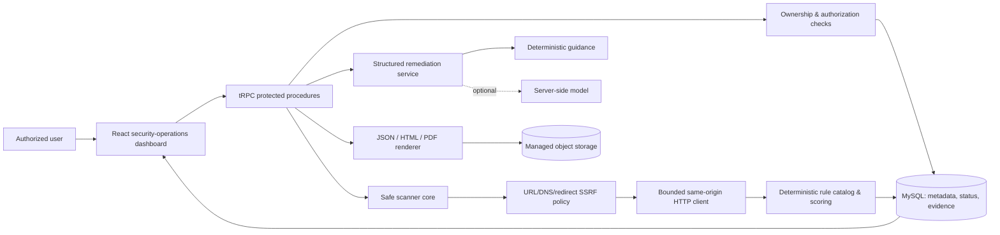

# Architecture

Arzens Sentinel separates **interface**, **assessment orchestration**, **deterministic scanning**, **advisory remediation**, and **artifact storage** so that the web dashboard does not become the scanner and AI never becomes the source of truth.

The scanner-core is intentionally shared between the server workflow and the local CLI. This keeps URL-safety enforcement, response limits, evidence redaction, rule IDs, and scoring consistent across user experiences.

## Trust boundaries

| Boundary | Design response |
|---|---|
| User supplied target | URL protocol, DNS resolution, IP category, and every redirect are checked before use. |
| Remote response | Response size, redirect count, timeout, page count, and same-origin discovery are bounded; credential-like values are redacted. |
| AI provider | Receives only normalized/redacted finding evidence and returns a strict schema; deterministic guidance is used if the provider is unavailable or invalid. |
| Database | Stores metadata and redacted evidence only; user ownership is verified before every target-specific operation. |
| Artifact storage | Stores report bytes outside the database; database retains only the storage key and retrievable URL metadata. |

## Extension path

The hosted profile remains Safe Passive. A separate local-only adapter normalizes OWASP ZAP output into the same stable finding model. Future authenticated crawling or active lab testing must remain local, require explicit authorization, and be isolated from the hosted service.
